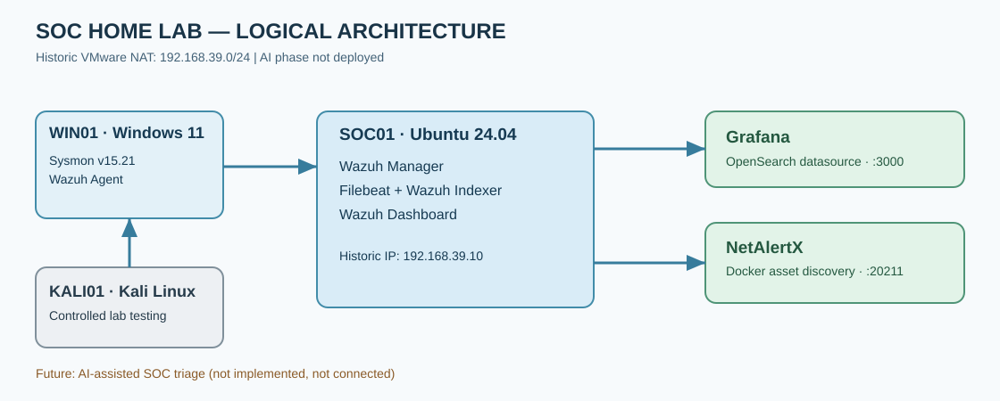
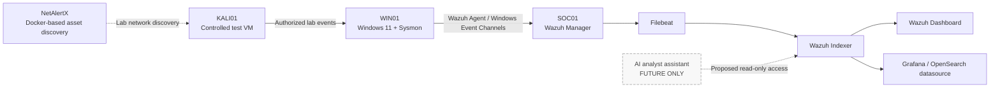

# SOC Home Lab with AI

**A virtual blue-team / Security Operations Center (SOC) home lab for centralized security monitoring, endpoint telemetry, network discovery, and security visualization.**

> **Project status (documentation date: 6 November 2026):** Core components were **implemented and observed working historically**, but the current health of the entire lab is **not confirmed**. The last documented Wazuh Manager startup incident (24 October 2026) was **not verified resolved**. **AI integration is planned, not deployed.**

## Project at a glance

| Area | Technology | Role / documented outcome |
|---|---|---|
| Virtualization | VMware NAT | Isolated learning network (`192.168.39.0/24` historically) |
| SIEM | Wazuh 4.14.7 on Ubuntu Server 24.04 LTS | Central manager, indexer, Filebeat and dashboard; previously processed endpoint events |
| Windows telemetry | Windows 11 + Wazuh Agent + Sysmon 15.21 | Event IDs 1 and 3 historically observed |
| Network visibility | NetAlertX via Docker | Previously identified lab devices, including Kali Linux |
| Visualization | Grafana + OpenSearch-compatible datasource | Historically queried Wazuh alert indices |
| Controlled testing | Kali Linux | Lab-only security-event simulation and validation |
| AI-assisted triage | Proposed later phase | **Not built / not integrated / not operational** |

**Author:** Adib Nasrallah  
**Programme:** Diploma in Computer Technology (Security), TVET MARA Sik, Kedah  
**Historical project period:** August–November 2026

## Objectives

- Centralize Windows endpoint security events using Wazuh.
- Collect detailed process and network telemetry with Sysmon.
- Visualize indexed alerts through Wazuh Dashboard and Grafana.
- Track assets on the isolated virtual network using NetAlertX.
- Validate detections with repeatable lab tests and record real troubleshooting evidence.
- Plan a **future**, read-only AI-assisted SOC triage component.

## Architecture / event flow

This diagram is a logical representation, **not a live service-health dashboard**. Grafana and NetAlertX are historically hosted on SOC01, but NetAlertX should not be interpreted as a verified unified alert-correlation pipeline with Wazuh.

## Implementation evidence and limitations

| Item | Best-supported status |
|---|---|
| Windows Sysmon process and network events | Historically observed |
| Wazuh detections (including rules 92057 / 92213) | Historically observed; verify current rule meanings |
| Grafana query of Wazuh indexes | Historically observed |
| NetAlertX asset discovery | Historically observed |
| Wazuh Manager after 24 Oct 2026 failure | **Recovery not verified** |
| Windows failed-logon and SSH/web scenarios | Procedures documented; latest results not verified |
| AI-based event triage | **Future development; not implemented** |

## Documentation index

| Start here | Description |
|---|---|
| [START-HERE.md](START-HERE.md) | Beginner-friendly guide in Bahasa Melayu: GitHub basics and how to publish this repository |
| [Executive summary](docs/00-executive-summary.md) | Scope and evidence confidence |
| [Introduction](docs/01-introduction.md) | Problem, goals and project boundaries |
| [Development timeline](docs/02-development-timeline.md) | Recorded milestones and implementation caveats |
| [Architecture](docs/03-architecture.md) | VMs, hosts, ports and telemetry flow |
| [Ubuntu preparation](docs/04-ubuntu-server.md) | Network and capacity diagnostics, explained command by command |
| [Wazuh SIEM](docs/05-wazuh-siem.md) | Deployment history and service verification |
| [Windows + Sysmon](docs/06-windows-sysmon.md) | Endpoint event collection and telemetry |
| [NetAlertX](docs/07-netalertx.md) | Network inventory and Docker checks |
| [Grafana](docs/08-grafana.md) | Indexer connectivity and visualization |
| [Security validation](docs/09-security-validation.md) | Historically observed tests vs proposed tests |
| [Troubleshooting](docs/10-troubleshooting.md) | Wazuh startup incident and previous configuration mistakes |
| [Operational security](docs/11-operational-security.md) | Security controls and resource limits |
| [Future AI roadmap](docs/12-future-ai-roadmap.md) | Future design, no claim of live AI |
| [Acceptance checklist](docs/13-acceptance-checklist.md) | Remaining criteria to confirm a healthy system |
| [Conclusion](docs/14-conclusion.md) | Project conclusion and boundaries |

**Reference material:** [Command matrix](docs/reference/command-matrix.md) · [Evidence register](docs/reference/evidence-register.md) · [Glossary and official references](docs/reference/glossary-references.md)

## Optional diagnostic helpers

- [`scripts/linux/health-check.sh`](scripts/linux/health-check.sh): **read-only** Ubuntu / Wazuh / Docker state snapshot (newly prepared helper, not a claim of historical execution).
- [`scripts/windows/endpoint-health.ps1`](scripts/windows/endpoint-health.ps1): **read-only** Windows agent / Sysmon check (new example).
- [`configs/examples/sysmon-event-channel.xml`](configs/examples/sysmon-event-channel.xml): XML fragment for illustration only; **do not overwrite an existing agent configuration** with this fragment.

Read the detailed documentation first. **Do not rerun the Wazuh all-in-one installer to repair an existing deployment.**

## Important security notes

This repository documents an **authorized educational lab**. The historical `192.168.39.0/24` addresses are private lab identifiers, not public services. Do not commit passwords, Wazuh API keys, Indexer certificates/private keys, personal identifiers in raw logs, virtual disks, or real environment backup files. Validate access controls and redact evidence before publishing any new information in this **public** repository.

The report contains historical observations and some planned commands. It is **not** a turnkey production SOC deployment nor a working AI application.

## Source and attribution

Adapted from the attached 26-page *SOC Home Lab with AI — Technical Development, Validation & Troubleshooting Report* dated **6 November 2026**. The original 26-page Word report is retained offline pending review for public disclosure. Documentation has been split into navigable Markdown files; an extra starter guide and diagnostic examples were newly prepared for GitHub usability.