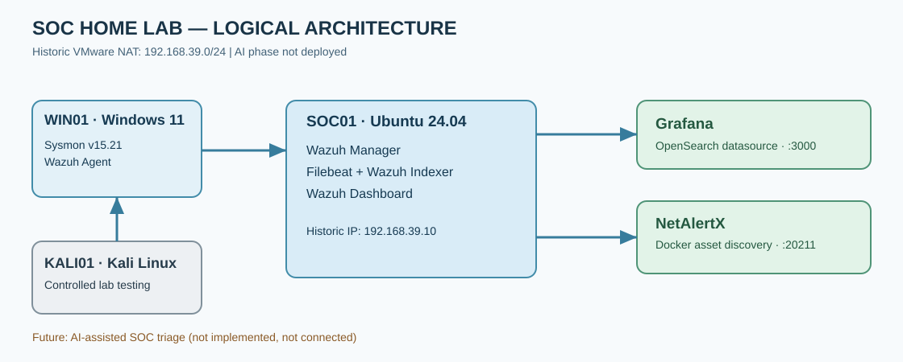
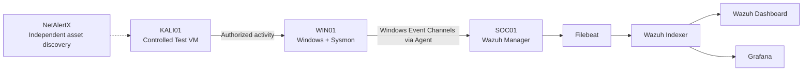

# 3. Lab Inventory and Network Architecture

> **Evidence scope:** Historic lab records (August–November 2026). Addresses are examples of the observed VMware NAT deployment, not guarantees of current reachability.

## 3.1 Environment and system roles

| System | OS and components | Historical address | Role |
|---|---|---|---|
| Host laptop | Windows, VMware; 16 GB RAM and approximately 346 GB free storage at an earlier stage | VMware VMnet8 | Runs the virtual machines |
| **SOC01** | Ubuntu Server 24.04 LTS, Wazuh 4.14.7, Filebeat, Indexer, Dashboard, Grafana and NetAlertX | `192.168.39.10` | Central security monitoring and visualization |
| **WIN01** | Windows 11, Wazuh Agent and Sysmon v15.21 | `192.168.39.130`, later `.138` | Monitored endpoint and source of telemetry |
| **KALI01** | Kali Linux | `192.168.39.128` on a recorded date | Authorized controlled-test VM |

The later lab subnet was **`192.168.39.0/24`**. Dynamic addressing may change between sessions. The two historical WIN01 addresses do not indicate simultaneous interfaces.

## 3.2 Logical architecture

**Implementation boundary:** Wazuh, Windows telemetry, network discovery and visualization were observed historically. An AI analyst assistant is a future phase and is not deployed.

## 3.3 Event pipeline

1. **Sysmon** records selected Windows process and network events based on the active XML policy.
2. The **Windows Wazuh Agent** reads configured Event Channels and sends telemetry to SOC01.
3. The **Wazuh Manager** parses events and evaluates detection rules.
4. **Filebeat** forwards indexed alert documents into the Wazuh Indexer.
5. **Wazuh Dashboard** presents searches and detections; **Grafana** can query OpenSearch-compatible indices with appropriate permissions.
6. **NetAlertX** identifies network assets. It does not replace packet capture or an endpoint EDR, and its data was not demonstrated as a unified Wazuh correlation pipeline.

## 3.4 Services and ports

| Endpoint | Purpose | Verification |
|---|---|---|
| SOC01 TCP **1514** | Wazuh agent event channel | Agent can connect to manager |
| SOC01 TCP **1515** | Wazuh enrollment | Enrollment listener when required |
| SOC01 TCP **443** | Wazuh Dashboard | HTTPS application responds |
| TCP **9200** (restrict access) | Wazuh Indexer API | Authenticated TLS query succeeds |
| TCP **55000** (restrict access) | Wazuh API | Authorized request responds |
| SOC01 TCP **3000** | Grafana UI | Grafana web UI responds |
| SOC01 TCP **20211** (historical) | NetAlertX web UI | Actual Docker-mapped port responds |

**Security:** Keep the lab isolated. Do not publish Indexer or administrative API ports to the internet. Inside a Docker bridge network, `localhost` refers to the container's network namespace, not necessarily the Ubuntu host.

## 3.5 What this architecture does not prove

A listener on a port does not mean the end-to-end telemetry pipeline works. Confirm service health, source events, Wazuh alerts and successful retrieval from Indexer/Grafana using **fresh timestamps** before claiming that the lab is currently functional.

*Source: SOC Home Lab Technical Development, Validation & Troubleshooting Report (6 November 2026), chapter 3.*
